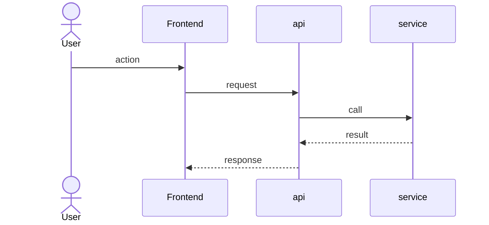

<!-- Title: type(scope): subject -->
<!-- Branch: feature/xxx -> main -->

## Summary

<!-- What changes and why, 1-3 sentences. -->

Related PR: <!-- link to the paired frontend/backend PR, or remove -->

## Related task

<!-- Ticket / BA task / issue link -->

## Type of change

- [ ] feat
- [ ] fix
- [ ] refactor / perf
- [ ] chore / docs / test / build
- [ ] BREAKING CHANGE (contracts, API or DB) - deploy order written below

## Changes by module

### `<app or folder>` - `<module>`

- <!-- what changed in this module, one bullet per behaviour -->

<!-- Repeat one ### block per module. Use a table for new/changed routes:
| Route | Auth | Notes |
|---|---|---|
-->

## Sequence

<!-- One mermaid diagram per main flow. Use alt/else for error branches. -->

## Screenshots

<!-- Frontend only - remove for backend PRs. One shot per user-visible module, captioned with the
module name. Generate with the pr-screenshots skill (_tools/e2e/scripts/pr-shots.mjs +
_tools/pr-preview/upload-shots.sh), which prints blocks like:

**Module - what it shows**

/<repo>/blob/pr-assets/pr-<n>/01-name.png?raw=true" width="900">
-->

## Affected workspaces

- <!-- e.g. apps/api -->

## Impact on other services

<!-- API/message contracts, DB tables other services read, ops prerequisites, deploy order. "None" if none. -->

## How it was tested

- <!-- test files added/updated -->
- <!-- paste real test/typecheck output -->

## Checklist

- [ ] Commits follow `type(scope): subject`; hooks were not skipped (or the reason is written here)
- [ ] Build / typecheck and the affected tests pass
- [ ] No secrets, `.env` files or personal data in code, logs or fixtures
- [ ] Docs updated if behaviour changed
